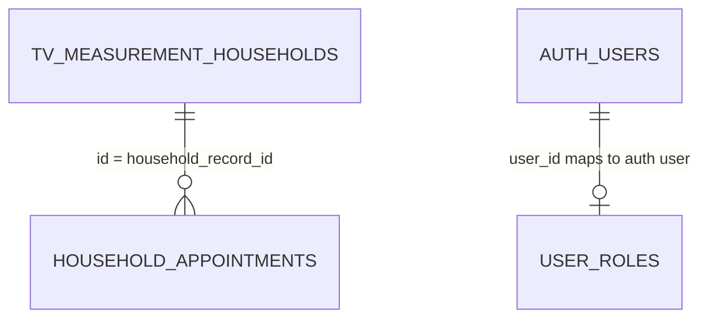

# Database Schema

## Evidence and limitations
The supplied repository archive contains no migrations, schema dump, generated database types, or SQL setup scripts. This document describes only table/column usage evidenced by application queries. Types, defaults, indexes, foreign keys, RLS policies, triggers, and exact nullability are **UNKNOWN / NEEDS VERIFICATION** against the Supabase project.

## Tables referenced

### `tv_measurement_households`
Main household records table. Columns directly referenced by source include:
- `id` — record identifier used in API paths and relationship lookups.
- `appointment_status`
- `call_status`
- `scheduled_date`
- `appointment_call_status`
- `installation_status`

The dashboard/table also references additional display fields for household identity, contact, region/address, and appointment-related information; exact full column list must be checked against the live schema or source query projections.

Status values in `app/api/households/[id]/route.ts`:
- `call_status`: `call successful`, `Not reachable`, `Number does not connect`
- `appointment_call_status`: `Scheduled`, `Rejected`
- `installation_status`: `pending`, `installed`, `rejected`

The API normalizes case/whitespace for these values before updating.

### `household_appointments`
Appointment history/entries linked to household records. Columns referenced:
- `id`
- `household_record_id`
- `scheduled_at`
- `created_by`
- `created_at`

Queries filter by `household_record_id` and order by `scheduled_at` ascending. Inserts set `household_record_id`, normalized ISO timestamp `scheduled_at`, and authenticated user ID in `created_by`. Deletion filters by appointment `id`.

### `user_roles`
Application-level role mapping. Columns referenced:
- `user_id`
- `role`

Reads use `.maybeSingle()` by `user_id`; admin listing selects `user_id, role`; role assignment inserts or updates a row. Uniqueness on `user_id` is assumed by code behavior but is **not confirmed** from this archive.

## Relationships (inferred from query usage)

These are application-level relationships inferred from code. Actual foreign-key constraints and delete behavior are not present in the repository.

## Business constraints implemented in application code
- Only company-domain users are allowed through household and appointment API handlers.
- Appointment creation requires the household's `appointment_call_status` to equal `Scheduled`.
- Appointment creation is restricted to `call_center`.
- Appointment deletion is restricted to `call_center`.
- Household PATCH updates are restricted to `call_center` or `field_executive`, with role-specific field validation.
- Admin user creation assigns a `user_roles` record; if role insertion fails, the newly created Auth user is deleted as a compensating action.

## Security and integrity checks to verify
1. Confirm RLS is enabled and policies are appropriate for all three tables.
2. Confirm `household_appointments.household_record_id` references `tv_measurement_households.id`.
3. Confirm `created_by` references `auth.users.id` and decide desired deletion behavior.
4. Confirm `user_roles.user_id` is unique and references `auth.users.id`.
5. Confirm status constraints/defaults and indexes exist in the deployed database.
6. Verify whether household and appointment business rules are also enforced by database policies/constraints, not only route handlers.
