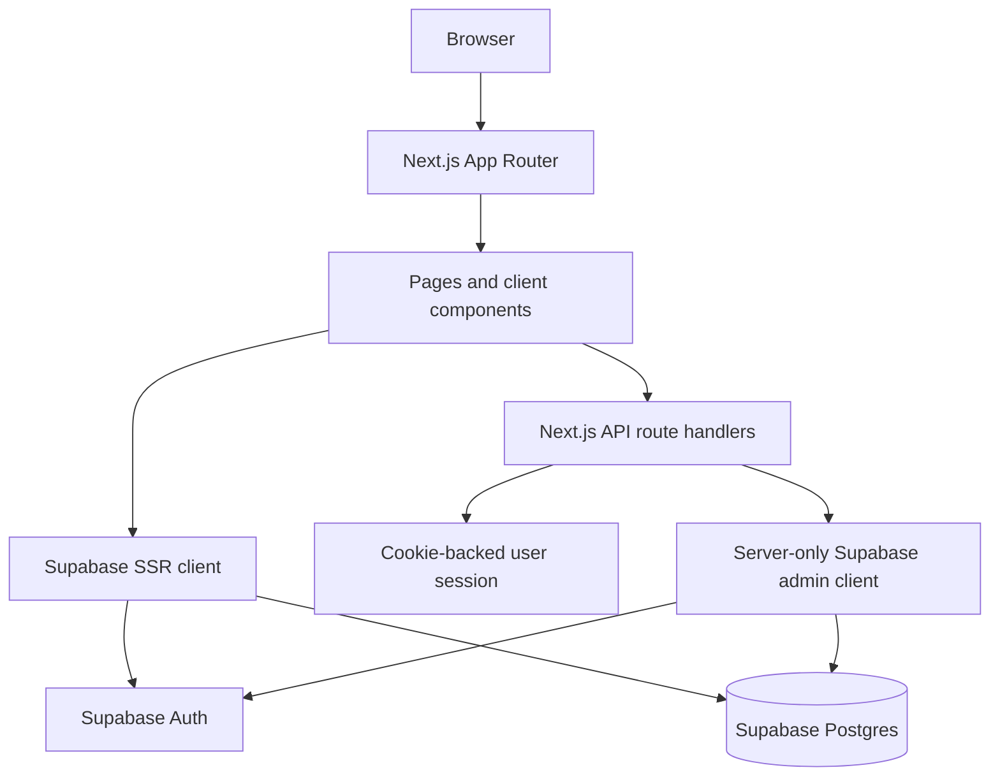
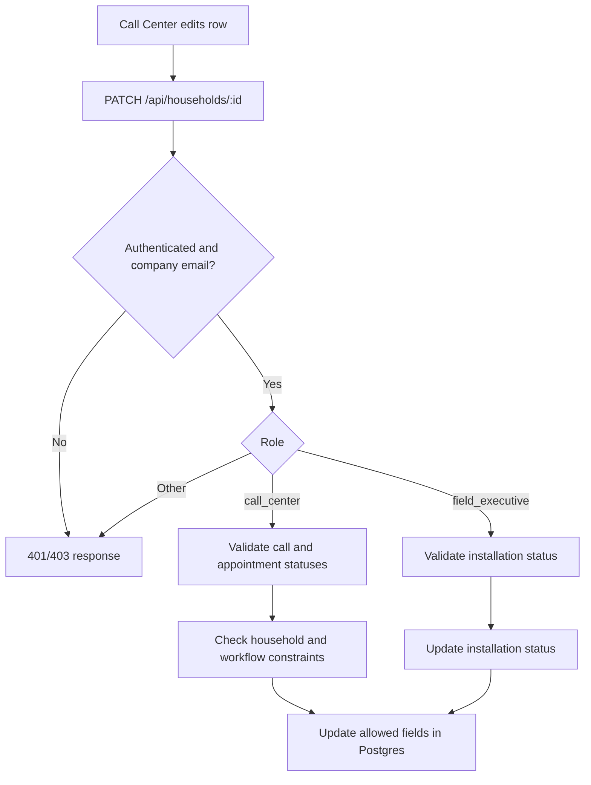

# Technical Architecture

## Stack
- Next.js `16.4.0`, App Router, React `19.3.0`, TypeScript.
- Supabase Auth and Postgres, accessed through `@supabase/ssr` and `@supabase/supabase-js`.
- Tailwind CSS v4 / Turbopack integration and reusable UI components.
- ESLint 9 with Next.js Core Web Vitals and TypeScript presets.

See `package.json`, `next.config.ts`, `eslint.config.mjs`, and `tsconfig.json`.

## High-level architecture



The browser-side Supabase client uses the publishable key. Server rendering uses a cookie-aware client. Privileged API handlers use a server-only admin client initialized with `SUPABASE_SERVICE_ROLE_KEY` or `SUPABASE_SECRET_KEY`; this bypasses normal user-scoped database authorization and makes server-side role checks important.

## Authentication and authorization
- `app/login/page.tsx` normalizes the email and performs a client-side company-domain check before `signInWithPassword`.
- `src/lib/supabase/server.ts` connects Supabase SSR auth to Next.js cookies.
- `src/lib/supabase/require-admin.ts` authenticates a user and checks `user_roles.role === 'admin'`.
- Household mutation and appointment APIs independently check session, company email domain, and application role.
- Admin APIs use `requireAdmin()` and privileged Supabase operations.
- The domain check in the login UI is not a substitute for server authorization; APIs repeat the check where implemented.

## Household update flow



The UI also applies progressive editability (call outcome before appointment status; scheduled status before adding appointments). The API is the authoritative boundary for checks that are actually implemented; UI disabling alone should not be considered security enforcement.

## Runtime configuration
Environment variable names referenced in source:
- `NEXT_PUBLIC_SUPABASE_URL`
- `NEXT_PUBLIC_SUPABASE_PUBLISHABLE_KEY`
- `SUPABASE_SERVICE_ROLE_KEY` (preferred by admin helper)
- `SUPABASE_SECRET_KEY` (fallback supported by admin helper)

Values must be supplied through the deployment environment and must not be committed. `.env` contents were not documented or reproduced.

## Run/build/lint
From repository root:
```bash
npm install
npm run dev
npm run build
npm start
npm run lint
```
`npm start` serves the production build and therefore normally follows `npm run build`. No test script is defined in `package.json`. No deployment workflow or hosting configuration is included; the README mentions Vercel as a generic Next.js deployment option, not proof of an active deployment.

## Error handling
API handlers generally return JSON `{ error: string }` for failures and use HTTP status codes such as 400, 401, 403, 404, and 500. Several handlers log detailed errors server-side and return generic messages to clients. Some admin routes return underlying Supabase error messages; review this before production use.
